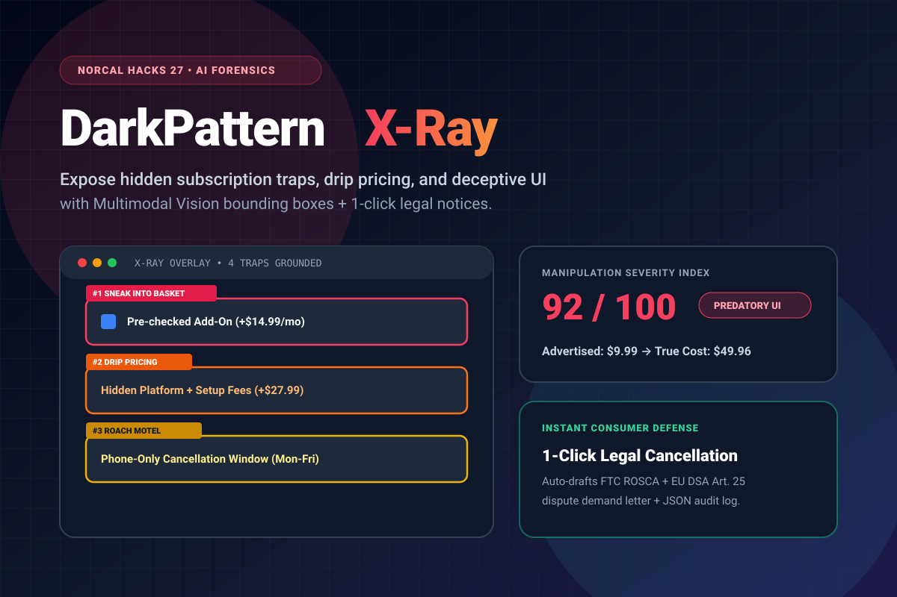
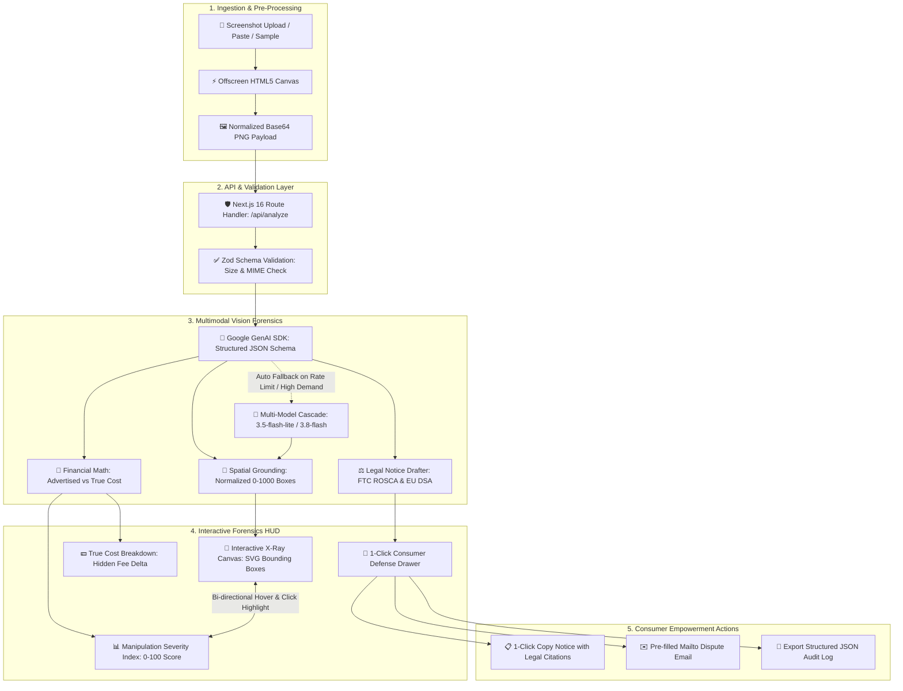

<p align="center">
  
</p>

<p align="center">
  <strong>Expose hidden subscription traps, drip pricing, confirmshaming, and roach motels in any checkout or UI screenshot using Multimodal Vision AI.</strong>
</p>

<p align="center">
  <a href="https://nextjs.org/"></a>
  <a href="https://react.dev/"></a>
  <a href="https://www.typescriptlang.org/"></a>
  <a href="https://tailwindcss.com/"></a>
  <a href="https://ai.google.dev/"></a>
  <a href="#license"></a>
</p>

<p align="center">
  🏆 <em>Built for <strong>NorCal Hacks 2026</strong> • Tracks: <strong>Social Impact</strong> &amp; <strong>New Frontiers</strong></em>
</p>

---

## ⚡ Executive Summary

Modern checkout flows, subscription modals, and cancellation mazes routinely exploit cognitive vulnerabilities. Companies manipulate users into recurring charges through:
* **Drip Pricing:** Concealing mandatory platform, maintenance, or service fees until the final payment step.
* **Sneak into Basket:** Pre-checking costly warranty, subscription, or priority handling add-ons.
* **Confirmshaming:** Weaponizing emotionally manipulative copy against users who opt out (*"No thanks, I hate saving money"*).
* **Roach Motels:** Offering seamless 1-click signup while trapping subscribers in phone-only or multi-step cancellation mazes.

**DarkPattern X-Ray** is an open-source consumer protection forensics tool. It ingests any interface screenshot and instantly outputs an interactive visual audit complete with **pixel-accurate spatial bounding boxes**, a **True Financial Cost breakdown**, and a **1-click statute-citing legal demand letter**.

---

## 🚀 Key Features

| Capability | Technical Implementation | Consumer Benefit |
| :--- | :--- | :--- |
| **🎯 Pixel-Accurate Visual Grounding** | Normalized `[0–1000]` coordinate bounding boxes mapped to SVG layers. | Instantly spots deceptive widgets, pre-selected checkboxes, and microscopic disclaimer clauses. |
| **🧮 True Cost Calculator** | Algorithmic delta analysis: Headline Advertised Price vs. Actual First-Year Cost. | Unmasks hidden monthly rebills, setup fees, and non-consensual recurring commitments. |
| **⚖️ 1-Click Consumer Defense Notice** | Auto-drafted dispute letters citing **FTC ROSCA**, **EU DSA Art. 25**, and **CCPA §1798.140**. | Generates an instant, legally backed cancellation email and refund demand. |
| **🧪 1-Click Preset Scenarios** | Vector-scaled real-world checkout, cancellation maze, and travel booking UI samples. | Zero-friction onboarding to test the system immediately without preparing images. |
| **🔄 Multi-Model Failover Resilience** | Automatic failover across Gemini models (`gemini-3.5-flash-lite`, `gemini-3.5-flash`, `gemini-3.8-flash`). | Prevents quota disruptions and ensures high-availability forensics scanning. |
| **💾 Structured Forensics Export** | Standardized JSON export matching regulatory submission requirements. | Provides evidentiary audit trails for credit card chargeback disputes and regulatory filings. |

---

## 📊 Application Architecture & Flow



### Detailed Pipeline Stages

1. **Client-Side Image Ingestion:**
   Screenshots can be dragged into the dropzone, selected via file explorer, pasted directly from the clipboard (`Ctrl+V`), or chosen from preset test cases. An offscreen HTML5 canvas normalizes dimensions and rasterizes the payload into a clean PNG.
2. **Strict Server-Side Validation:**
   The Next.js 16 Route Handler validates payload size (`< 8 MB`) and image MIME type (`image/png`, `image/jpeg`, `image/webp`) using a strict **Zod** schema.
3. **Structured Gemini Multimodal Vision Forensics:**
   The backend invokes `@google/genai` with a constrained JSON schema. The model analyzes visual hierarchy, micro-typography, pre-selected checkboxes, and color contrast ratios while computing exact bounding box coordinates `[ymin, xmin, ymax, xmax]`.
4. **Interactive Forensics Workspace:**
   The X-Ray Canvas locks in place and overlays color-coded bounding boxes. Hovering over a bounding box highlights the corresponding finding card in the right-hand inspection drawer, and vice versa.
5. **Enforcement & Action Toolkit:**
   Users can open the legal defense drawer to copy the formal cancellation notice, trigger an email via `mailto:` to the vendor's billing department, or export the full JSON forensics report.

---

## 🔬 Deceptive Design Taxonomy (9 Regulated Categories)

DarkPattern X-Ray maps detected interface tricks against established regulatory enforcement frameworks:

| Category | Description | Primary Psychological Trigger | Statutory Violation Cited |
| :--- | :--- | :--- | :--- |
| **💸 Drip Pricing** | Mandatory booking, processing, or platform fees omitted until the final review step. | Sunk Cost Fallacy & Anchoring | FTC Section 5 Unfair Trade Practices |
| **🛒 Sneak into Basket** | Pre-checked add-on boxes for insurance, subscriptions, or tips. | Default Bias & Inertia | EU Digital Services Act (DSA) Art. 25 |
| **🪤 Roach Motel** | Asymmetric friction where onboarding takes 1 click, but cancellation requires phone calls. | Friction & Task Exhaustion | FTC ROSCA (15 U.S.C. § 8401) |
| **🥺 Confirmshaming** | Emotionally manipulative, condescending opt-out links (*"No, I prefer paying full price"*). | Social Disapproval & Guilt | FTC Policy Statement on Dark Patterns |
| **⏰ False Scarcity** | Artificial countdown clocks, fake viewer counts, or simulated stock depleting alerts. | FOMO & Urgency Bias | FTC Guides Against Deceptive Pricing |
| **👁️ Visual Misdirection** | High-contrast accept buttons paired with low-contrast, nearly invisible decline links. | Visual Saliency Exploitation | CCPA / CPRA § 1798.140 |
| **🔄 Forced Continuity** | Free trials that automatically convert to paid subscriptions without reminder notices. | Hyperbolic Discounting | Restore Online Shoppers' Confidence Act |
| **❓ Trick Questions** | Double negatives and confusing opt-out checkbox phrasing. | Cognitive Overload | EU General Data Protection Regulation (GDPR) |
| **🔍 Hidden Subscription** | Recurring billing obligations obscured in faint, collapsed terms of service links. | Inattention & Information Asymmetry | CFPB Circular 2023-01 on Negative Option Traps |

---

## 🛠️ Tech Stack & Architecture

| Layer | Technology | Version / Tooling | Purpose |
| :--- | :--- | :--- | :--- |
| **Framework** | [Next.js](https://nextjs.org/) | `16.4.6` (App Router, Turbopack) | Serverless route handlers, streaming UI, and modern React runtime. |
| **UI Library** | [React](https://react.dev/) | `19.3.0` | Client-side reactive HUD and canvas overlay synchronization. |
| **Language** | [TypeScript](https://www.typescriptlang.org/) | `^5.0` | Strict type definitions across forensics schemas and API payloads. |
| **Styling** | [Tailwind CSS](https://tailwindcss.com/) | `v4.3.3` + `@tailwindcss/turbopack` | Ultra-fast design tokens, dark HUD palette, and custom animations. |
| **Multimodal Vision** | [Google GenAI SDK](https://www.npmjs.com/package/@google/genai) | `@google/genai ^3.3.0` | Spatial bounding box extraction and structured schema generation. |
| **Schema Validation**| [Zod](https://zod.dev/) | `^4.6.7` | Runtime type safety and payload boundary verification. |
| **Iconography** | [Lucide React](https://lucide.dev/) | `^1.72.0` | Accessible HUD indicators and category badges. |

---

## 🧪 Pre-loaded Forensic Test Scenarios

DarkPattern X-Ray includes 3 sample interfaces to test the engine without needing to take screenshots:

1. **StreamVault Ultra Checkout (`/samples/streamvault-checkout.svg`)**
   * **Domain:** SaaS / Streaming
   * **Detected Patterns:** Hidden 400% platform drip fee, pre-checked 4K add-on, forced annual rollover, and confirmshaming cancel link.
   * **Risk Verdict:** `Predatory` (Score: 92/100).
2. **CloudNest Cancellation Maze (`/samples/cloudnest-cancel.svg`)**
   * **Domain:** Cloud Storage / Backup
   * **Detected Patterns:** Roach motel telephone hurdle, double-negative opt-out questions, and disguised billing disclaimers.
   * **Risk Verdict:** `Deceptive` (Score: 78/100).
3. **SkyFare Express Flight Booking (`/samples/skyfare-booking.svg`)**
   * **Domain:** Travel / Aviation
   * **Detected Patterns:** Fabricated countdown urgency, pre-selected carbon offset and priority boarding fees, and faint baggage fee disclosures.
   * **Risk Verdict:** `Deceptive` (Score: 84/100).

---

## 💻 Local Setup & Development

### Prerequisites

* **Node.js:** `v20.x` or higher
* **Package Manager:** `npm`, `pnpm`, or `yarn`
* **Google Gemini API Key:** Obtainable free from [Google AI Studio](https://aistudio.google.com/)

### 1. Clone the Repository

```bash
git clone https://github.com/prabhattopi/darkpattern-xray.git
cd darkpattern-xray
```

### 2. Install Dependencies

```bash
npm install
```

### 3. Configure Environment Variables

Create a `.env.local` file in the project root:

```bash
cp .env.example .env.local
```

Add your Google AI Studio API key:

```env
# Google AI Studio API Key
GEMINI_API_KEY=your_gemini_api_key_here

# Primary Vision Model (Optional - defaults to gemini-3.8-flash or gemini-3.5-flash-lite)
GEMINI_MODEL=gemini-3.5-flash-lite
```

> [!TIP]
> The engine automatically fails over through `gemini-3.5-flash-lite`, `gemini-3.5-flash`, `gemini-3.8-flash`, and `gemini-3.1-flash-lite` if high demand or quota limits occur.

### 4. Run the Development Server

```bash
npm run dev
```

Open [http://localhost:3000](http://localhost:3000) in your browser.

### 5. Production Build

```bash
npm run build
npm run start
```

---

## 📡 API Specification

### Analyze Screenshot

* **Endpoint:** `POST /api/analyze`
* **Content-Type:** `application/json`

#### Request Payload

```json
{
  "imageBase64": "iVBORw0KGgoAAAANSUhEUgAA...",
  "mimeType": "image/png"
}
```

#### Response Structure

```json
{
  "success": true,
  "model": "gemini-3.5-flash-lite",
  "report": {
    "productName": "StreamVault Ultra",
    "pageType": "Subscription Checkout",
    "manipulationScore": 92,
    "riskVerdict": "Predatory",
    "advertisedPriceUsd": 9.99,
    "trueFirstYearCostUsd": 119.88,
    "hiddenCostUsd": 71.94,
    "summary": "The checkout uses drip fees and a pre-checked add-on to triple the headline price.",
    "patterns": [
      {
        "id": "dp-1",
        "category": "Sneak into Basket",
        "title": "Pre-Checked 4K Streaming Add-On",
        "severity": "critical",
        "confidence": 98,
        "box": {
          "ymin": 420,
          "xmin": 120,
          "ymax": 490,
          "xmax": 880
        },
        "quotedText": "Add Ultra-HD Pro (+$5.99/mo)",
        "explanation": "Add-on checkbox is pre-selected by default without explicit affirmative consent.",
        "psychologicalTrigger": "Default Bias",
        "estimatedFinancialImpactUsd": 71.88,
        "legalReference": "EU DSA Art. 25 & FTC Negative Option Rule"
      }
    ],
    "cancellationNotice": {
      "subjectLine": "Formal Notice of Disputed Charges and Cancellation",
      "recipientRole": "Billing & Compliance Department",
      "legalBasis": "FTC ROSCA (15 U.S.C. § 8401) & EU DSA Article 25",
      "letterBody": "To whom it may concern,\n\nI am writing to formally dispute recurring charges..."
    }
  }
}
```

---

## ⚖️ Legal & Regulatory Citations

DarkPattern X-Ray grounds its assessments in active regulatory enforcement mandates:

* **FTC Restore Online Shoppers' Confidence Act (ROSCA - 15 U.S.C. § 8401):** Mandates simple cancellation mechanisms equal in ease to initial sign-up ("Click-to-Cancel").
* **EU Digital Services Act (DSA - Regulation (EU) 2022/2065, Art. 25):** Prohibits providers of online platforms from designing, organizing, or operating interfaces that deceive or manipulate recipients.
* **California Consumer Privacy Act (CCPA / CPRA § 1798.140):** Explicitly defines dark patterns as designs that impair consumer autonomy and invalidates consent obtained through them.
* **FTC Section 5 (15 U.S.C. § 45):** Deploys enforcement against unfair or deceptive acts impacting commerce and drip pricing schemes.

---

## 🛡️ License

This project is licensed under the **MIT License** — see the [LICENSE](LICENSE) file for details.

---

<p align="center">
  Crafted with care for <strong>NorCal Hacks 2026</strong>. Protecting consumer autonomy on the web.
</p>
